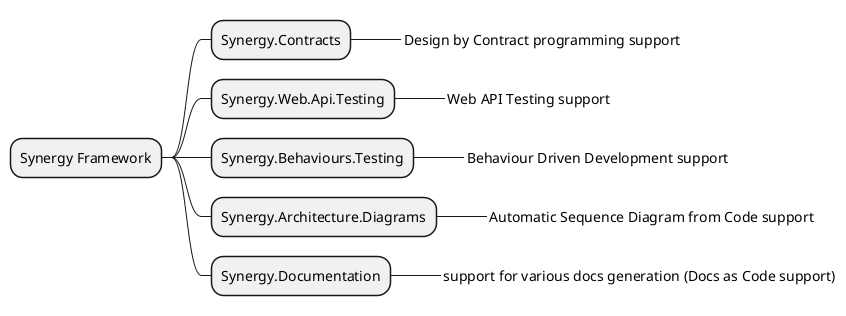

# synergy.framework

[](https://ci.appveyor.com/project/MarcinCelej/synergy-framework)

[//]: # (TODO Actualize this file)

<!--

-->
 <!-- ← Generated image link. Do NOT modify it manually. -->

[Design by contract programming](https://github.com/synergy-software/synergy.framework/wiki/Contracts)

[Architecture Diagrams  as Code](Architecture/README.md)

[Docs As Code](Documentation/README.md)

## Supported frameworks and CI

.NET 5, 6 and 7 are no longer targeted. Modern tests, test helpers and the sample
Web API run on .NET 10. Libraries that previously targeted .NET 8 retain that
target alongside .NET 10. Existing .NET Standard 2.0 and .NET Framework 4.7.2/4.8
targets are unchanged.

Build with the .NET 10 SDK. On Windows, the legacy projects also require the
.NET Framework targeting packs; their .NET Framework tests still run separately.
No .NET 5, 6 or 7 runtime installation or major-version roll-forward is needed.

AppVeyor configuration is maintained in the project settings. Use a Windows image
with the .NET 10 SDK/runtime and the .NET Framework targeting packs. Remove the
legacy runtime installer from **Settings > Build > Before build script** and keep:

```powershell
dotnet restore
if ($LASTEXITCODE -ne 0) { throw 'dotnet restore failed.' }
nuget restore
if ($LASTEXITCODE -ne 0) { throw 'nuget restore failed.' }
```

Select **PowerShell** for this script. Keep the existing build, packaging and
test steps; modern test projects can still be run with `dotnet test --no-build`
after the build.
